# Controllers
Controller được sử dụng để xử lý các yêu cầu,  và trả về phản hồi cho client

# Models
Model là thành phần đại diện cho dữ liệu và cấu trúc logic của đối tượng trong ứng dụng. Đây là các lớp Java thông thường chứa các thuộc tính, cùng các phương thức getter và setter để truy xuất dữ liệu mà không chứa các logic nghiệp vụ phức tạp.

# Routes
Routes là cơ chế khớp các đường dẫn URL trên trình duyệt với các thành phần, trang hoặc chức năng tương ứng mà không cần phải tải lại toàn bộ trang web, trong Spring boot thường nằm trong Controller

# Services

services là nơi để xử lý logic nghiệp vụ, thường chứa các interface, chứa các class cài đặt interface.

# Migration

Migration là quá trình quản lý, theo dõi và tự động áp dụng các thay đổi về cấu trúc (schema) hoặc dữ liệu của database theo thời gian

## File application.properties

File application.properties là nơi lưu trữ toàn bộ các thiết lập và tham số cấu hình để vận hành ứng dụng như:
- Cấu hình máy chủ
- Cấu hình database
- Cấu hình mồi trường...

# Xây dựng RESTful API

## HTTP Methods và Mapping URL đến hàm xử lý
### GET
Phương thức GET được sử dụng để yêu cầu dữ liệu từ một tài nguyên cụ thể.

Annotation: @GetMapping

VD:
```java
@GetMapping("/get")
    public String Get(){
        return "Success";
    }
```
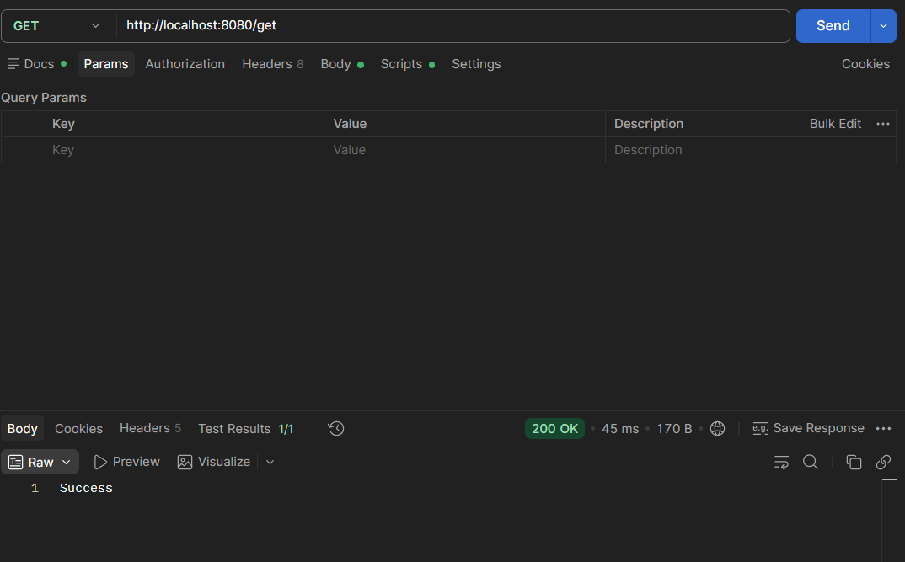

### POST
Phương thức POST được sử dụng để tạo mới tài nguyên, gửi thông tin tới sever thông qua các biêu mẫu.

Annotation: @PostMapping

VD:
```java
@PostMapping("/Data")
    public String data(){
        return "Success";
    }
```
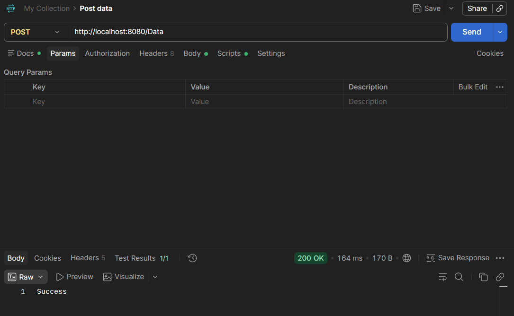

### PUT
Phương thức PUT được sử dụng để cập nhật tất cả thông tin của đối tượng với những gì được gửi lên.

Annotation: @PutMapping

VD:
```java
@PutMapping("/Update")
    public String update(){
        return "Success";
    }
```
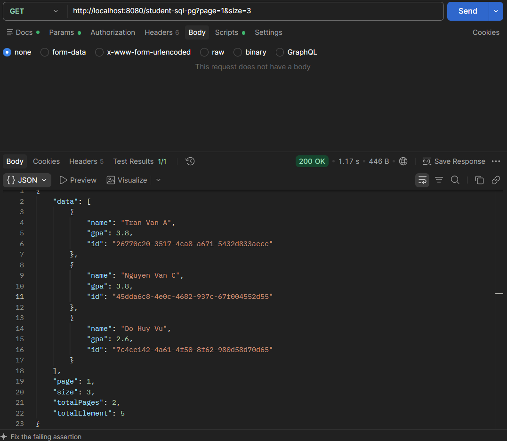

### PATCH
Phương thức PATCH cũng được sử dụng để cập nhật dữ liệu nhưng khác với PUT nó chỉ cập nhật 1 số thông tin của đối tượng.

Annotation: @PatchMapping

### DELETE

Phương thúc DELETE được sử dụng để xóa tài nguyên trên server.

Annotation: @DeleteMapping

VD:
```java
@DeleteMapping("/Delete")
    public String delete(){
        return "Delete Success";
    }
```
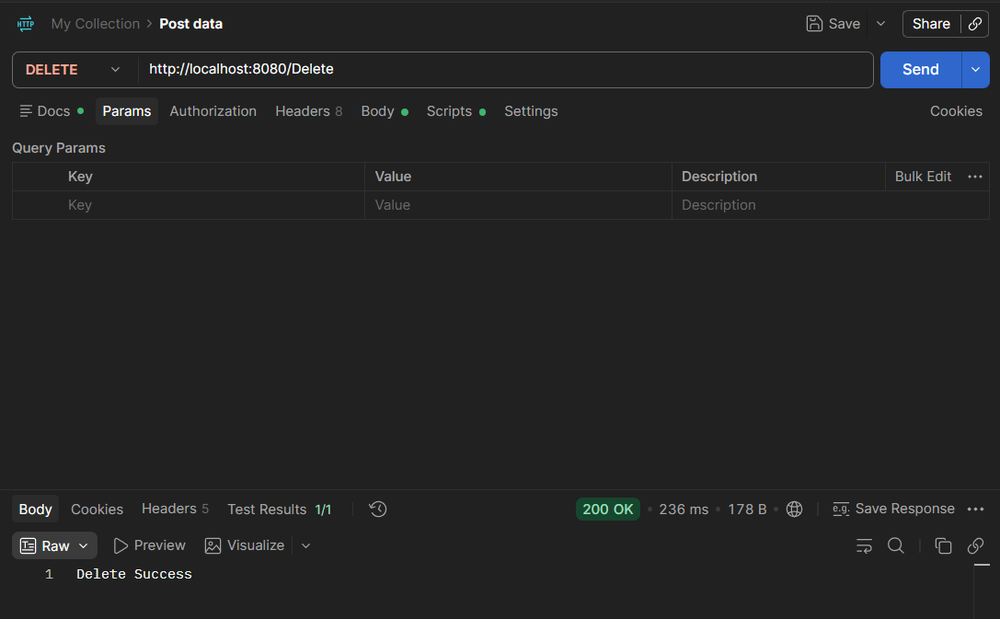

## Xử lý Request

### Path Variable

Annotation: @PathVariable 

Nó được sử dụng để trích xuất các giá trị từ đường dẫn URI của một yêu cầu. Nó thường được sử dụng trong các API REST, nơi các tài nguyên được xác định trực tiếp trong URL. -> Dùng để truy cập dữ liệu.

Vd:
```java
  @GetMapping("/users/{id}")
    public String GetId(@PathVariable int id){
        return "user nay co id: " + id;
    }
```
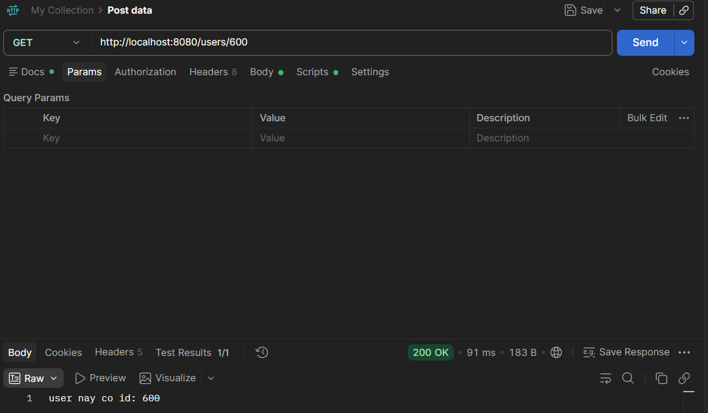

### Query Param

Annotation: RequestParam

Nó được sử dụng để trích xuất giá trị từ các tham số truy vấn trong URL. Nó thường được sử dụng khi gửi dữ liệu tùy chọn, bộ lọc hoặc tham số tìm kiếm trong các yêu cầu. -> dùng để tìm kiếm, phân trang....

VD:
```java
@GetMapping("/users")
    public String Search(@RequestParam("age") int age){
        return "user nay co age la " + age;
    }
```
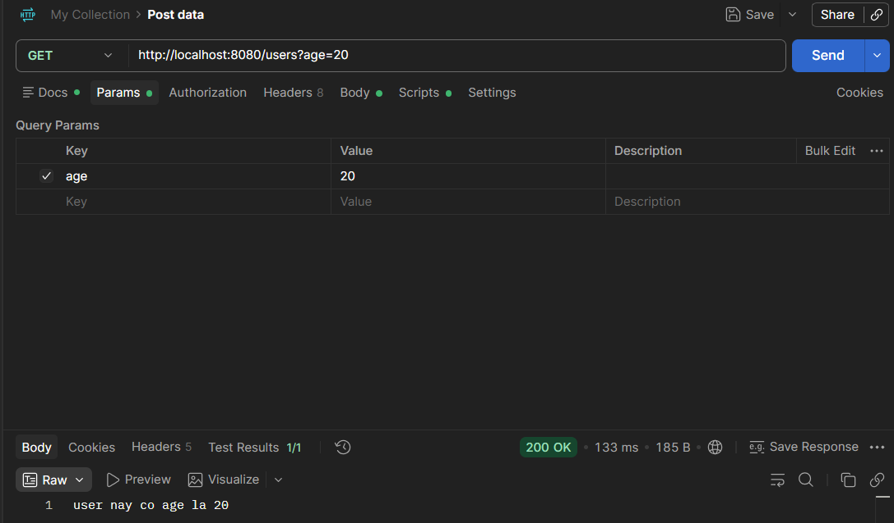

### Request Body: JSON payload

Annotation: @RequestBody 

Nó được sử dụng để lấy nội dung (body) của HTTP request, chuyển thành object Java và gán vào tham số này.

## Xử lý Response

### Trả về JSON

Với @RestController khi return sẽ tự động được chuyển thành JSON.

VD:

```java
@GetMapping("/users")
    public SinhVien get(){
        SinhVien a = new SinhVien("B24DCCN600", "Tran Anh Tuan", 3.6);
        return a;
    }
```
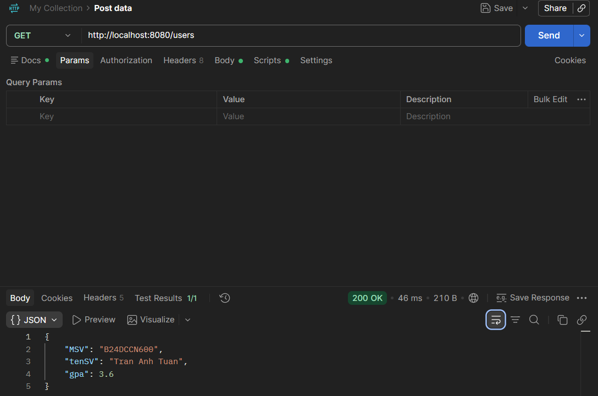

### HTTP Status Code

- HTTP status code (mã trạng thái) là mã code server trả về sau mỗi lần gửi request. Tất cả các request mà server nhận được đều sẽ được trả về 1 response với 1 mã code tương ứng. Các HTTP status code là chuẩn để server trả về. HTTP status code giúp xác định request thành công hay không, nếu thất bại thì nguyên nhân là gì.
- HTTP Status Code gồm 3 chữ số.
- HTTP Status Code 2xx(Sucess – Thành công):
    - 200 OK: Request đã được tiếp nhận và xử lý thành công.
    - 201 Created: Request đã được tiếp nhận và xử lý thành công và 1 tài nguyên mới được tạo trên server.
- HTTP Status Code 4xx(Client Error – Lỗi Client):
    - 400 Bad Request: Server không thể xử lý hoặc sẽ không xử lý các Request lỗi của phía client (ví dụ Request có cú pháp sai)
    - 404 Not Found: Trang được yêu cầu không tồn tại tại thời điểm hiện tại, tuy nhiên có thể tồn tại trong tương lai.
- HTTP Status Code 5xx(Server error – Lỗi server):
    - 500 Internal Server Error: Một thông báo chung chung, được đưa ra khi Server bị lỗi bất ngờ (chủ yếu do lỗi lập trình, kết nối database)

## Error Handling

### Cấu trúc error response thống nhất
```docx
code – mã định danh duy nhất cho lỗi
message – một thông điệp ngắn gọn
details – giải thích dài hơn về lỗi
```
VD:
```json
{
    "code": 401,
    "message": "Incorrect username and password",
    "details": "Ensure that the username and password included in the request ar"
}
```


### Phân biệt client error (4xx) vs server error (5xx)

- Client error (4xx): Mã lỗi là các phản hồi lỗi cho biết có vấn đề ở phía máy khách, có thể do sự cố mạng.

- Server error(5xx): Mã lỗi là các phản hồi cho biết lỗi ở phía server.

## Phân trang trong API và Thực hành

Xậy dụng Xây dựng API CRUD cho đối tượng student

```java
public class Student {
    private String name, id;
    private double gpa;
    public Student(){
    
    }
    public Student(String id, String name, double gpa){
        this.name = name;
        this.id = id;
        this.gpa = gpa;
    }
    
    public String getName() {
        return name;
    }

    public void setName(String name) {
        this.name = name;
    }

    public String getId() {
        return id;
    }

    public void setId(String id) {
        this.id = id;
    }

    public double getGpa() {
        return gpa;
    }

    public void setGpa(double gpa) {
        this.gpa = gpa;
    }   
}
```
### GET có phân trang
```java
// Lay danh sach Sinh Vien phan trang
    @GetMapping("/students")
    public ResponseEntity<Object> get(@RequestParam int page, @RequestParam int size){
        return StudentService.getP(page, size);
    }
```

```json
{
    "data": [
        {
            "id": "B24DCCN600",
            "name": "Tran Anh Tuan",
            "gpa": 2.6
        },
        {
            "id": "B24DCCN100",
            "name": "nguyen Van A",
            "gpa": 3.0
        },
        {
            "id": "B24DCCN200",
            "name": "Do Van V",
            "gpa": 3.0
        },
        {
            "id": "B24DCCN101",
            "name": "Le Minh Hoang",
            "gpa": 3.2
        },
        {
            "id": "B24DCCN102",
            "name": "Pham Thu Huong",
            "gpa": 3.8
        },
        {
            "id": "B24DCCN103",
            "name": "Vu Duc Thang",
            "gpa": 2.4
        },
        {
            "id": "B24DCCN104",
            "name": "Hoang Thi Lan",
            "gpa": 3.5
        },
        {
            "id": "B24DCCN105",
            "name": "Bui Quang Huy",
            "gpa": 2.9
        },
        {
            "id": "B24DCCN106",
            "name": "Dang Ngoc Mai",
            "gpa": 3.9
        },
        {
            "id": "B24DCCN107",
            "name": "Nguyen Hai Nam",
            "gpa": 2.1
        }
    ],
    "page": 1,
    "size": 10,
    "totalPages": 1,
    "totalElement": 13
}
```
### GET tìm theo id
```java
 // Tim kiem Sinh Vien theo id
    @GetMapping("/students/{id}")
    public ResponseEntity<Object> search(@PathVariable String id){
        return StudentService.search(id);
    }
```
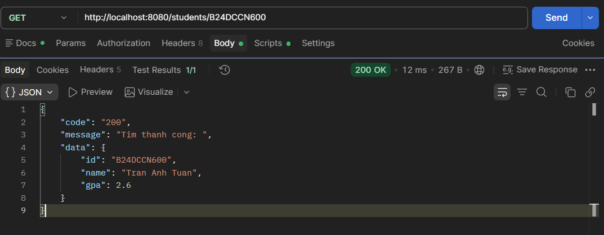
### POST
```java
    // Them Sinh Vien
    @PostMapping("/new-student")
    public ResponseEntity<Object> add(@RequestBody Student Student){
        return StudentService.create(Student);
    }
```
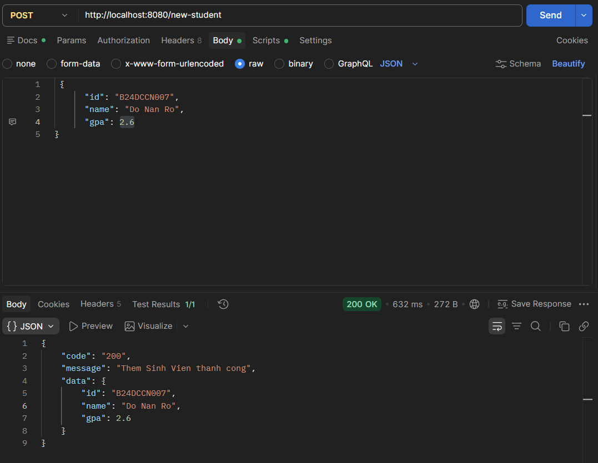
### PUT/PATCH
```java
@PatchMapping("/{id}")
    public ResponseEntity<Object> replace(@PathVariable String id, @RequestBody double gpa){
        return StudentService.replace(id, gpa);
    }
```
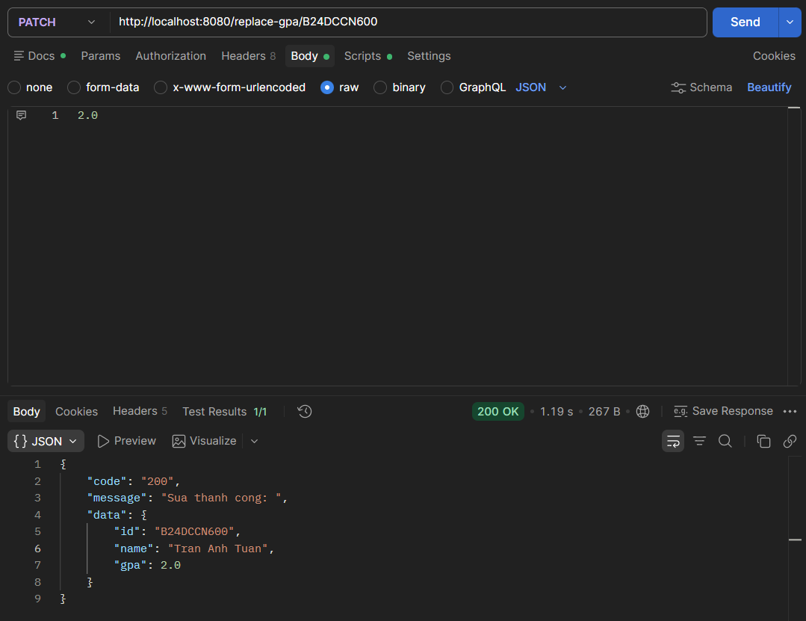
### DELETE
```java
// Xoa Sinh Vien
    @DeleteMapping("/delete-student/{id}")
    public ResponseEntity<Object> remove(@PathVariable String id){
        return StudentService.remove(id);
    }
```
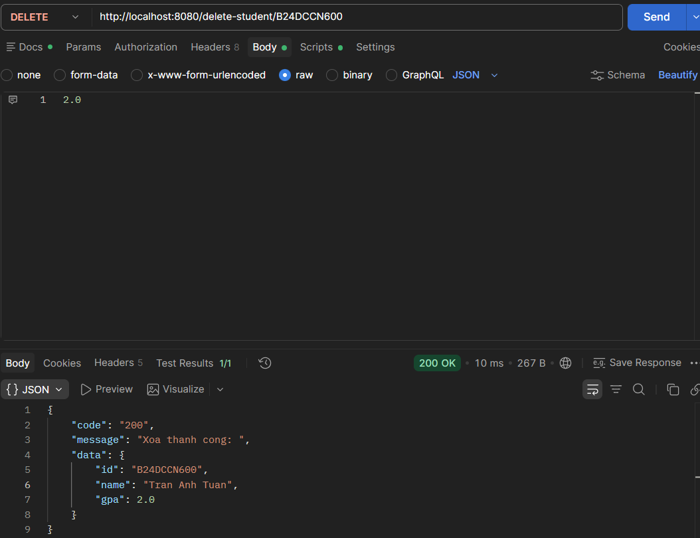

# ORM

## ORM là gì ?

ORM( Object-Relational Mapping) là 1 kỹ thuật lập trình giúp ánh xạ các record dữ liệu trong hệ quản trị cơ sở dữ liệu sang dạng đối tượng đang định nghĩa trong các class
### Cơ chế hoạt động của ORM

ORM hoạt động bằng cách kết nối ứng dụng hướng đối tượng với cơ sở dữ liệu quan hệ. Do hai bên tổ chức dữ liệu theo cách khác nhau, ORM sẽ thực hiện ánh xạ để ứng dụng có thể trao đổi dữ liệu với database mà không cần xử lý trực tiếp toàn bộ cấu trúc bảng và câu lệnh SQL.

## ORM có lợi ích gì ?

### ORM có thể:
- Giảm lượng mã SQL thủ công: ORM hỗ trợ thực hiện các thao tác CRUD thông qua object, model và method, từ đó hạn chế phải viết lặp lại nhiều câu truy vấn SQL.

- Tăng tốc độ phát triển: Lập trình viên có thể tập trung nhiều hơn vào logic nghiệp vụ thay vì xử lý từng thao tác truy cập dữ liệu.

- Code dễ đọc và bảo trì: Cách tổ chức dữ liệu theo class và object giúp cấu trúc mã nguồn rõ ràng, thuận tiện khi mở rộng hệ thống.

- Quản lý quan hệ dữ liệu thuận tiện: ORM thường hỗ trợ sẵn các quan hệ như One-to-One, One-to-Many và Many-to-Many.

- Hỗ trợ nhiều hệ quản trị cơ sở dữ liệu: Một số ORM framework cho phép làm việc với MySQL, PostgreSQL, SQL Server hoặc các database khác mà không cần thay đổi quá nhiều logic ứng dụng.

# Sử dụng ORM theo Framework và thực hành

# Định nghĩa cốt lõi: JPA, Hibernate, Spring Data JPA, Entity Mapping, Repository

## 1. JPA

**JPA (Jakarta Persistence API)** là **đặc tả chuẩn** của Java cho ORM: chỉ gồm interface và annotation (`@Entity`, `@Id`, `EntityManager`, JPQL), **không có code thực thi**. Spring Boot 3 dùng package `jakarta.persistence`.

## 2. Hibernate

**Hibernate** là thư viện **cài đặt JPA** (provider mặc định của Spring Boot). Nó đọc annotation, sinh SQL theo từng loại DB, chuyển `ResultSet` thành object, và tự theo dõi thay đổi để UPDATE (dirty checking).

> JPA là "bản thiết kế", Hibernate là "bên thi công".

## 3. Spring Data JPA

**Spring Data JPA** là lớp trừu tượng nằm trên JPA/Hibernate: chỉ cần khai báo **interface**, framework tự sinh phần cài đặt (CRUD, phân trang, query theo tên method, `@Query`, `Specification`). Nó không thay thế Hibernate mà dùng Hibernate bên dưới.

```
Spring Data JPA → JPA → Hibernate → JDBC → Database
```

## 4. Entity Mapping

**Entity mapping** là khai báo cách ánh xạ một class Java sang một bảng trong DB:

| Java | Database |
|---|---|
| Class (`@Entity`) | Table |
| Object | Row |
| Field (`@Column`) | Column |
| `@Id` | Primary key |
| `@ManyToOne` / `@OneToMany` / `@OneToOne` / `@ManyToMany` | Foreign key / bảng trung gian |

Một entity cần: `@Entity`, `@Id`, constructor không tham số, class không `final`.

## 5. Repository

**Repository** là tầng truy cập dữ liệu, mô phỏng một **"bộ sưu tập object"**: bên ngoài chỉ gọi `save`, `findById`, `delete`... mà không quan tâm SQL hay DB. Trong Spring Data JPA, repository là một **interface** kế thừa `JpaRepository<Entity, KiểuId>`.

```java
public interface ProductRepository extends JpaRepository<Product, Long> { }
```

## Thực hành

Tạo bảng student ở MySQL
```sql
Create table student(
	id varchar(200) primary key,
	name varchar(200),
    gpa decimal(10, 1)
)
```
Tương ứng là class StudentSQl có id là khóa chính.
```java
@Entity
@Table(name = "student")
public class StudentSql {
    @Id
    @GeneratedValue(strategy = GenerationType.UUID)
    private String id;
    private String name;
    private double gpa;

    public StudentSql(String name, double gpa) {
        this.name = name;
        this.gpa = gpa;
    }
    
    public String getName() {
        return name;
    }

    public void setName(String name) {
        this.name = name;
    }

    public String getId() {
        return id;
    }

    public void setId(String id) {
        this.id = id;
    }

    public double getGpa() {
        return gpa;
    }

    public void setGpa(double gpa) {
        this.gpa = gpa;
    }
    
}
```
Annotation:
- @Entity dùng để đánh dấu class trong java trở thành 1 thực thể trong cơ sở dữ liệu.
- @Table dùng để chỉ định tên bảng trong cơ sở dữ liệu mà một lớp Java (Entity) ánh xạ tới.
- @Id dùng để chỉ định thuộc tính nào làm khóa chính.
- @GeneratedValue dùng để sinh khóa chính tự động

Repository
```java
@Repository
public interface RepositoryStudent extends JpaRepository<StudentSql, String>{   
}
```
### Đẩy dữ liệu vào database
 
Reponsitory.save(data): Lưu dữ liệu vào MySql

vd:
```java
    public StudentSql create(RequestStudent request){
        StudentSql nw = new StudentSql(request.getName(), request.getGpa());
        return Student.save(nw);
    }
```
```java
@PostMapping("/new-student-sql")
    public StudentSql add(@RequestBody RequestStudent RequestStudent){
        return StudentSqlService.create(RequestStudent);
    }
```
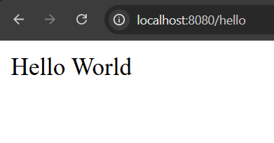
Trong MySQL
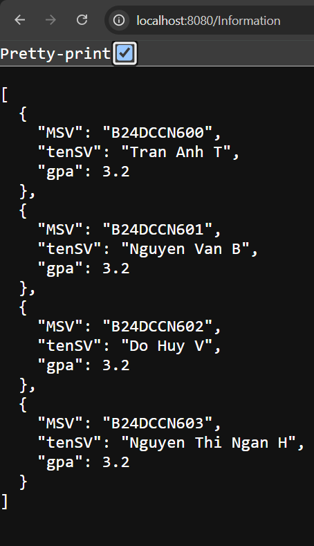

### Lấy dữ liệu từ MySql

Repository.findAll() trả về 1 list bản ghi trong database

vd
```java
    public ArrayList<StudentSql> get(){
        ArrayList<StudentSql> arr = (ArrayList<StudentSql>)Student.findAll();
        return arr;
    }
```
```java
    // Lay tat ca du lieu trong database
    @GetMapping("/student-sql")
    public Object get(){
        return StudentSqlService.get();
    }
    
```


### Phân trang 

Page<Object> + Repository.findAll(PageResponse.of(page, size))

vd:
```java
        public ResponsePagination pagination(int page, int size){
        Page<StudentSql> res = Student.findAll(PageRequest.of(page - 1, size));
        ResponsePagination tmp = new ResponsePagination(res.getContent(),page, size, res.getTotalPages(),(int)res.getTotalElements());
        return tmp;
    }
```
```java
@GetMapping("/student-sql-pg")
    public Object getPagination(@RequestParam int page,@RequestParam int size){
        return StudentSqlService.pagination(page, size);
    }
```


### Relationship giữa các Entity

### Định nghĩa

**Relationship** là cách khai báo mối liên hệ giữa hai entity, tương ứng với **khóa ngoại (foreign key)** giữa hai bảng trong DB.

| Annotation | Ý nghĩa | Ví dụ |
|---|---|---|
| `@ManyToOne` | **Nhiều** entity này thuộc về **một** entity kia | Nhiều sinh viên thuộc một lớp |
| `@OneToMany` | **Một** entity này có **nhiều** entity kia | Một lớp có nhiều sinh viên |

Hai annotation này là **hai mặt của cùng một quan hệ**: nhìn từ sinh viên là `@ManyToOne`, nhìn từ lớp là `@OneToMany`.