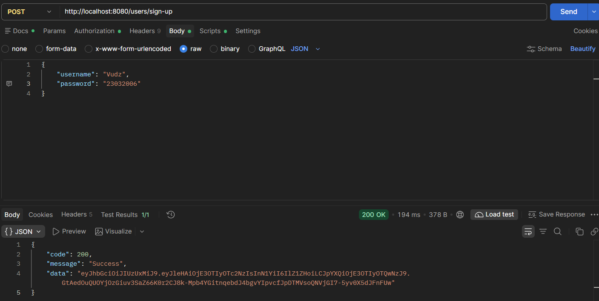
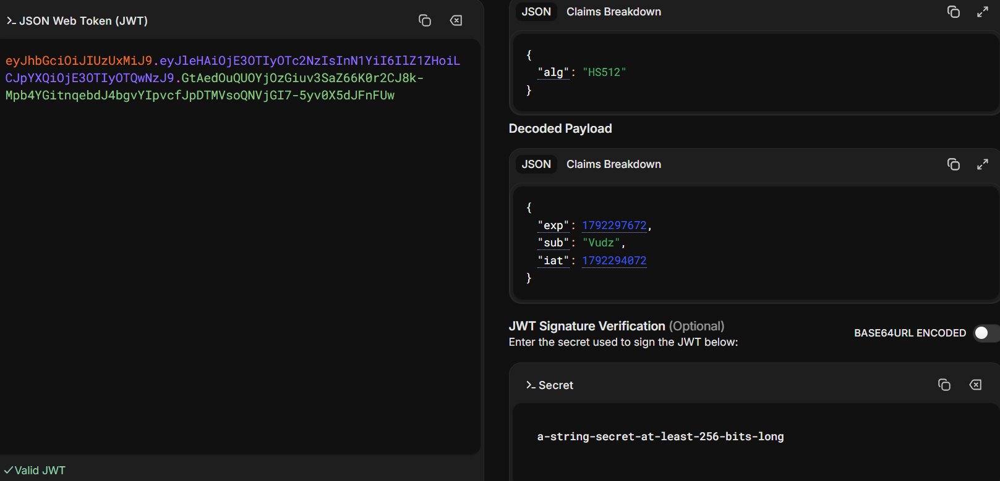
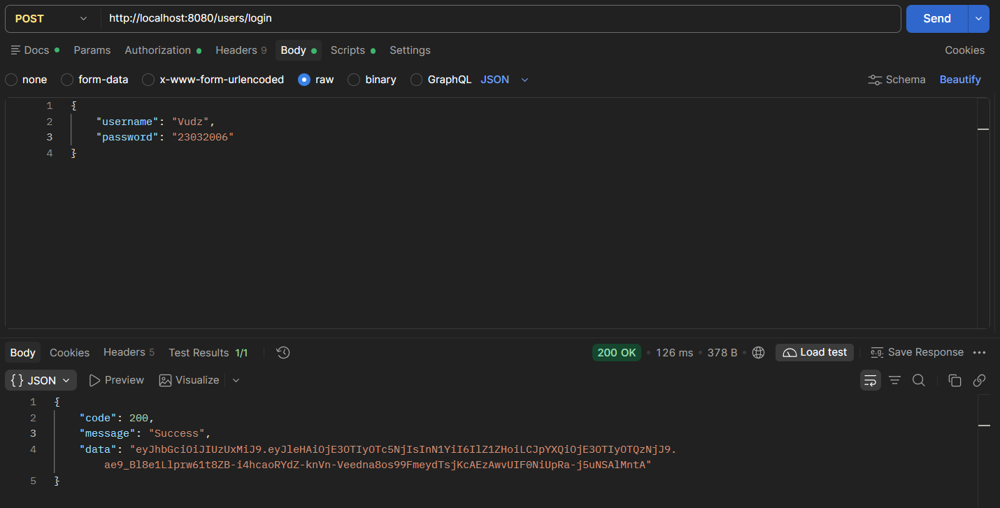
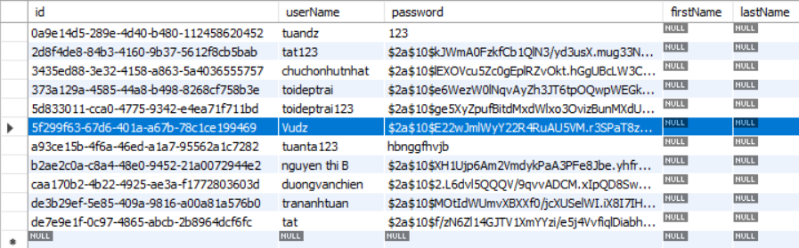
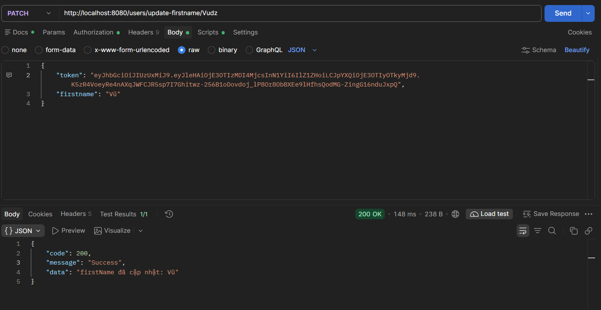
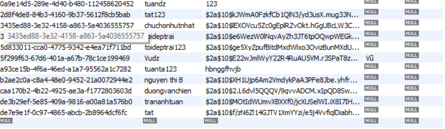
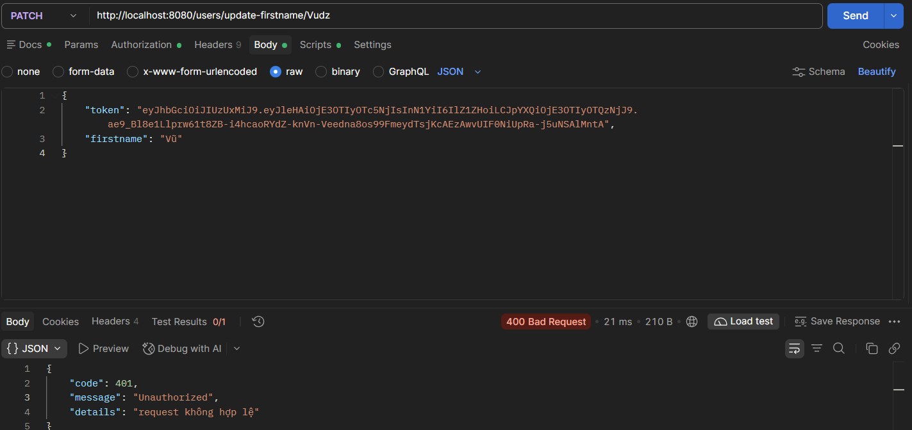

# Khái Niệm

## Authentication (Xác thực)
Authentication là quá trình xác minh danh tính của người dùng hoặc hệ thống. Nó đảm bảo người dùng là hợp pháp bằng cách xác thực các thông tin đăng nhập như mật khẩu, mã OTP hoặc sinh trắc học.


## Authorization (Ủy quyền)
Authorzation xác định quyền truy cập và các quyền được phép của người dùng đã được xác thực. Nó quyết định người dùng có thể truy cập những tài nguyên nào và được phép thực hiện những hành động nào.

## So sánh Authentication và Authorization

| Authentication | Authorization|
| :--- | :--- |
| Xác minh danh tính người dùng. | Xác định quyền truy cập của người dùng. |
| Được thực hiện trước Authorization. | Xảy ra sau khi Authentication. |
| Yêu cầu thông tin đăng nhập (tên người dùng, mật khẩu, sinh trắc học). | Yêu cầu vai trò, đặc quyền hoặc cấp độ truy cập của người dùng. |
| Xác định xem người dùng có hợp lệ hay không. | Xác định quyền hạn của người dùng hợp lệ. |
| Người dùng có thể thay đổi thông tin đăng nhập. | Chỉ chủ sở hữu hệ thống mới có thể thay đổi quyền truy cập. |
| Hiển thị cho người dùng (khi nhập thông tin đăng nhập). | Không hiển thị với người dùng (được xử lý ngầm). |
| Ví dụ: Mật khẩu, mã OTP, dấu vân tay, nhận diện khuôn mặt. | Ví dụ: Quyền quản trị, quyền đọc/ghi, quyền dựa trên vai trò. |

# Phân biệt cơ chế xác thực

## Session-based (Stateful)
### Định nghĩa
Session based là một cơ chế xác thực trong đó máy chủ tạo và duy trì một Session duy nhất cho mỗi người dùng sau khi đăng nhập thành công. Máy chủ lưu trữ dữ liệu Session, trong khi máy khách chỉ lưu trữ SessionID (thường là trong cookie) để xác định người dùng.
### Luồng hoạt động
1. Khi client truy cập vào web thì server sẽ tạo 1 SessionID duy nhất.
2. SessionID được lưu vào trong cookie của trình duyệt.
3. Server sẽ lưu trữ dữ liệu của Sesion tương ứng với SessionID (Server có thể lưu RAM, Redis hay DateBase).
4. Mỗi request tiếp theo của client sẽ gửi kèm cookie chứa SessionID
5. Server sẽ dùng SessionID để xác định người dùng và truy xuất dữ liệu.
- Khi người dùng thay đổi trình duyệt, thay đổi thiết bị, chuyển sang ẩn danh thì Server sẽ tạo 1 SessionID mới.

## Token-based (Stateless)
### Định nghĩa
Token based là một cơ chế xác thực dựa trên Token được sử dụng để truyền thông tin người dùng một cách an toàn giữa máy khách và máy chủ. Một Token có chứa tiêu đề, nội dung và chữ ký, cho phép máy chủ xác minh mã thông báo mà không cần lưu trữ Session.
### Luồng hoạt động
1. Người dùng đăng nhập bằng cách nhập thông tin đăng nhập hợp lệ.
2. Server sẽ xác thực người dùng.
3. Server tạo Token.
4. Token được gửi đến client và lưu trữ.
5. Khi client gửi request cùng với Token đã được cấp.
6. Server giải mã token xem người dùng có hợp lệ không.
7. Nếu hợp lệ, Server sẽ trả về dữ liệu được yêu cầu.

## So sánh

| Session based | Token based |
| :--- | :--- |
| Lưu trữ dữ liệu Session của người dùng trên máy chủ. | Lưu trữ dữ liệu xác thực trong Token trên máy khách. |
| Session được lưu trữ trên máy chủ. | Quá trình xác thực không lưu trữ trạng thái; máy chủ không lưu Session. |
| Cần có SessionID (thường được lưu trữ trong cookie) để xác thực. | Mỗi yêu cầu đều yêu cầu gửi kèm Token. |
| Khả năng mở rộng kém hơn vì máy chủ quản lý các Session hoạt động. | Khả năng mở rộng cao vì không cần lưu trữ Session ở phía máy chủ. |
| Thích hợp hơn cho các ứng dụng web truyền thống. | Thường được sử dụng trong API, SPA, ứng dụng di động và kiến trúc microservices. |
| Tăng mức sử dụng bộ nhớ máy chủ do quản lý Session. | Giảm tải cho máy chủ bằng cách loại bỏ việc lưu trữ Session. |

# JWT
## JWT là gì?
JWT( Json Web Token) là một tiêu chuẩn mở nhằm xác minh thông tin an toàn giữa các bên Client-Server dưới dạng JSON object. 
## Cấu trúc của JWT

### JWT có cấu trúc *Header.Payload.Signature*

1.Header: Trong header thướng có 2 phần đó là loại mã Token và thuật toán được sử dụng.

VD:
```json
{
    "alg": "HS256",
    "typ": "JWT"
}
```
Ở đâu,

- alg: Thuật toán được sử dụng (ví dụ: HS256, RS256).
- typ: Loại token, luôn là "JWT".

2.Payload: Chứa các thông tin về người dùng, còn được gọi là yêu cầu xác thức và một số thông tin bổ sung như thời gian phát hành và thời gian hết hạn...

VD:
```Json
{ 
    "studentId": "B24DCCN600", 
    "name": "Tran Anh Tuan", 
    "exp": 1672531199 
}
```
Các loại thông tin bổ sung thường gặp:

- iss (Issuer): Xác định đơn vị phát hành token.
- sub (Chủ thể): Đại diện cho người dùng hoặc thực thể mà mã thông báo này đề cập đến.
- aud (Đối tượng): Chỉ định người nhận dự định.
- exp (Thời hạn): Xác định thời điểm mã thông báo hết hạn.
- iat (Issued At): Thời điểm mã thông báo được tạo.
- nbf (Not Before) : Chỉ định thời điểm mã thông báo trở nên hợp lệ.

3.Signature: Đảm bảo tính toàn vẹn của mã thông báo và được tạo ra bằng cách sử dụng phần Header, Payload và một khóa bí mật.

## Lợi ích của JWT

- Giúp Authentication và Authorization.
- Kích thước nhỏ vì Json ngắn gọn nên khi mã hóa kích thước của nó cũng nhở hơn (VD: json có kích thước nhỏ hơn SAML)
- Tiện lợi vì Json rất phổ biến với mọi ngôn ngữ lập trình.

## Hạn chế và rủi ro bảo mật

- Nếu hacker biết được khóa bí mật ở phần Signature thì hoàn toàn có kiểm soạt được hệ thông.
- Việc giải mã phần header và payload dễ dàng.
- Do JWT là stateless nên khi hacker đánh cắp được thì sever sẽ không nhận ra do không biết là token ở tay ai.

*Cách khắc phục giảm rủi ro* 

- Token hết hạn ngắn
- Dùng Refresh Token
- Kiểm tra thêm ở server

# Password Hashing

## Tại sao không lưu password dạng plain text?
Nếu lưu password dưới dạng plain text khi dữ liệu bị do rỉ, hacker có thể dễ dàng chiếm đoạt tài khoản người dùng.Để tránh điều này, mật khẩu cần được băm( hash) trước khi lưu trữ.

## Tại sao không dùng MD5/SHA.
### MD5
- MD5 là viết tắt của "Message Digest Algorithm 5", là một thuật toán băm tiêu chuẩn được thiết kế để tạo ra một giá trị băm (hash value) có độ dài cố định từ một đoạn dữ liệu có độ dài bất kỳ. Giá trị băm được tạo ra thông qua MD5 thường là một chuỗi hex (hệ thập lục phân) có độ dài 32 ký tự (128 bit).
### SHA
* SHA là viết tắt của "Secure Hash Algorithm" là một loạt các thuật toán băm được thiết kế để tạo ra giá trị băm (hash value) có độ dài cố định từ một đoạn dữ liệu có độ dài bất kỳ. Các thuật toán trong loạt SHA thường được sử dụng trong nhiều ứng dụng bảo mật thường là 256 hoặc 512 bit.

### Nhược điểm

- Nếu biết trước độ dài thì hoàn hacker hoàn toàn có thể Brute force để do được mật khẩu.
- Rainbow table là một bảng tra cứu hash, nếu hash không có salt, hacker tra bảng có thể do ra mật khẩu.
- Riêng MD5 còn bị tấn công collision.

## Dùng /argon2: salt, cost factor

### Bcrypt là gì?
Bcrypt (1999, Niels Provos & David Mazières) là hàm băm mật khẩu dựa trên bước
thiết lập khóa tốn kém của thuật toán mã hóa Blowfish. Điểm mạnh:

- **Salt tự động:** mỗi mật khẩu sinh một salt ngẫu nhiên, nên cùng mật khẩu vẫn
  cho hash khác nhau và rainbow table vô dụng.
- **Cost factor (work factor):** số vòng lặp = 2^cost, có thể tăng dần để làm chậm
  brute force khi phần cứng mạnh lên.
- **One-way function:** không thể suy ngược ra mật khẩu gốc, kẻ tấn công chỉ có
  thể đoán rồi hash thử để so sánh.

**Hạn chế:** dùng rất ít RAM nên GPU/FPGA vẫn tấn công song song hiệu quả; chỉ xét
tối đa 72 byte đầu của mật khẩu.

### Argon2
Argon2 (thắng cuộc thi Password Hashing Competition 2015) cũng có salt và làm chậm
có chủ đích như bcrypt, nhưng là thuật toán **memory-hard**: trong lúc băm, hệ
thống phải cấp phát một lượng RAM nhất định để điền và trộn một ma trận dữ liệu.
Kẻ tấn công muốn thử nhiều mật khẩu song song thì phải có rất nhiều RAM, nên GPU/ASIC
mất lợi thế.

Ba tham số điều chỉnh được:
- **m (memory):** lượng RAM sử dụng
- **t (iterations):** số vòng lặp
- **p (parallelism):** số luồng song song

Có 3 biến thể (Argon2d, Argon2i, Argon2id); khuyến nghị dùng **Argon2id**.
# Thực hành

## Tạo API đăng ký, đăng nhập trả về 1 JWT

### Tạo JWT
```java
    protected static final String SIGNER_KEY = "Ma6LbMpM7HC65LAyRS38h64oPmDyEnSU98gU5Rkq07Yl30vdV9gW7irBMI9VEQ6hgpUKo7eq0RgSs5kj";
    
    private String generateToken(String username){
        JWSHeader header = new JWSHeader(JWSAlgorithm.HS512);
        JWTClaimsSet jwtclaimsset = new JWTClaimsSet.Builder()
                .subject(username)
                .issueTime(new Date())
                .expirationTime(new Date(Instant.now().plus(1, ChronoUnit.HOURS).toEpochMilli()))
                .build();
        Payload payload = new Payload(jwtclaimsset.toJSONObject());
        JWSObject jwtobject = new JWSObject(header, payload);
        
        try{
           jwtobject.sign(new MACSigner(SIGNER_KEY)); 
           return jwtobject.serialize();
        }
        catch(JOSEException e){
             throw new RuntimeException("Không thể tạo JWT", e);
        }
    }
```
### Service đăng ký, đăng nhập

Service đăng ký
```java
    public ResponseEntity<Object> create(RequestUser request){
        List<User> listuser= repositoryuser.findByusername(request.getUsername());
        
        if(listuser.size() != 0) throw new AppException(USER_NAME_EXIST);
        
        PasswordEncoder passwordEncoder = new BCryptPasswordEncoder(10);
        request.setPassword(passwordEncoder.encode(request.getPassword()));
        User newuser = new User(request.getUsername(), request.getPassword());
        repositoryuser.save(newuser);
        String token = generateToken(request.getUsername());
        return ResponseEntity.ok().body(new SuccessResponse(200, "Success", token));
    }
```
Controller
```java
@PostMapping("/users/sign-up")
    public Object signUp(@RequestBody RequestUser Request){
        return UserService.create(Request);
    }
```
Demo



Service đăng nhập
```java
    public ResponseEntity<Object> login(RequestUser request){
        List<User> list = repositoryuser.findByusername(request.getUsername());
        if(list.size() == 0) throw new AppException(USER_NOT_EXIST);
        PasswordEncoder passwordEncoder = new BCryptPasswordEncoder(10);
        if(passwordEncoder.matches(request.getPassword(), list.get(0).getPassword())){
            String token = generateToken(request.getUsername());
            return ResponseEntity.ok().body(new SuccessResponse(200, "Success", token));
        }
        else throw new AppException(USER_NOT_EXIST);
    }
```
Controller
```java
    @PostMapping("/users/login")
    public Object login(@RequestBody RequestUser Request){
        return UserService.login(Request);
    }
```
Demo


## Hashing mật khẩu khi đăng ký

Như code trên phần đăng ký tài khoản Vudz được lưu vào database và password được Hashing theo BCrypt.

password trước khi được hashing: 23032006

password sau khi được hashing: $10$E22wJmlWyY22R4RuAU5VM.r3SPaT8zpWdSulkDapUrghowknWjXke

## Tạo Middleware/Filter kiểm tra JWT cho các API protected

Kiểm tra token xem có khớp với token của server không.
```java
    private boolean check(String token) throws JOSEException, ParseException{
        JWSVerifier verifier = new MACVerifier(SIGNER_KEY.getBytes());
        SignedJWT signedJWT = SignedJWT.parse(token);
        
        Date expityTime = signedJWT.getJWTClaimsSet().getExpirationTime();
        return signedJWT.verify(verifier) && expityTime.after(new Date());
    }
```
service
```java
    public ResponseEntity<Object> update(String username, RequestFirstName request) throws JOSEException, ParseException{
        if(check(request.getToken()) != true){
            throw new AppException(TOKEN_ERROR);
        }
        else{
        List<User> listuser = repositoryuser.findByusername(username);
        if(listuser.size() == 0) throw new AppException(USER_NAME_EXIST);
        
        listuser.get(0).setFirstname(request.getFirstname());
        repositoryuser.save(listuser.get(0));
        return ResponseEntity.ok().body(new SuccessResponse(200, "Success", "firstName đã cập nhật: " + request.getFirstname()));
        }
    }
```
Controller
```java
    @PatchMapping("/users/update-firstname/{username}")
    public Object replace(@PathVariable String username, @RequestBody RequestFirstName request) throws JOSEException, ParseException{
        return UserService.update(username, request);
    } 
```

### Demo cho API cập nhật firstName phải kiểm tra JWT.



Nếu dùng token không hợp lệ

